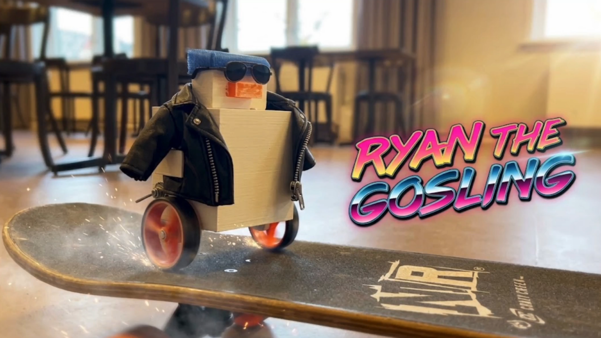
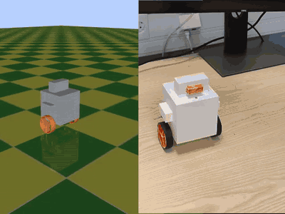
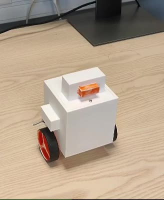
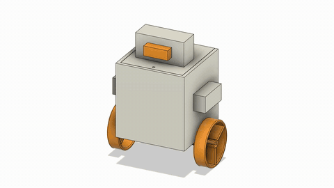
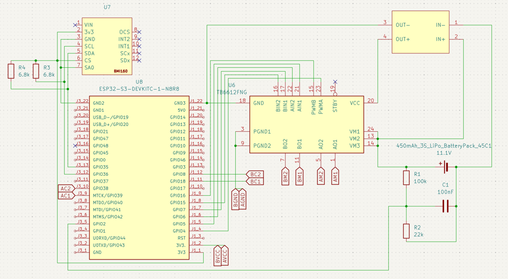
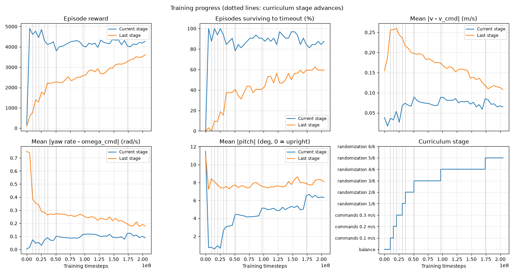
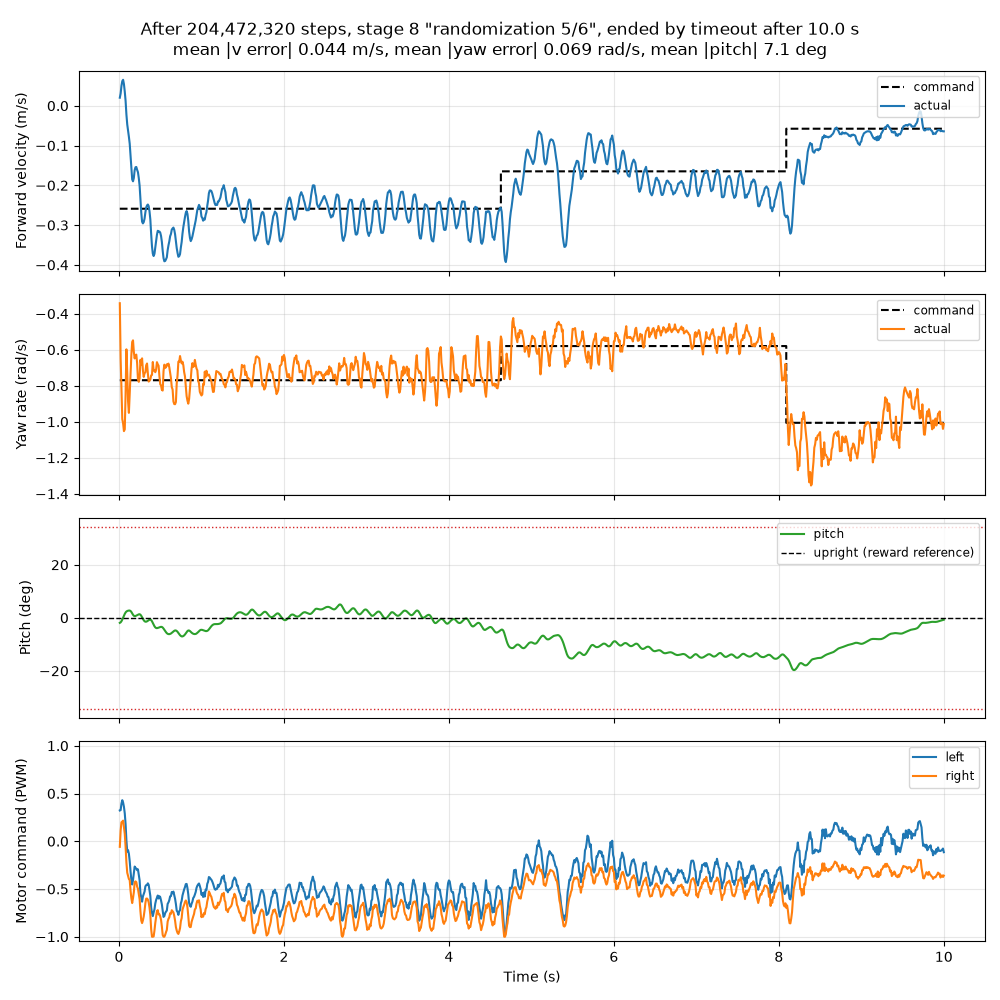
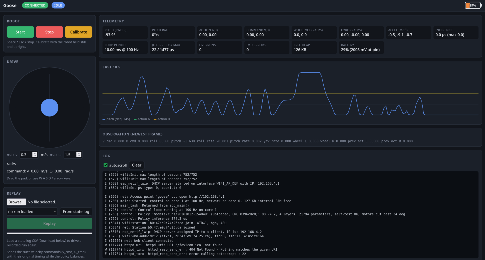

# Mini Goose

<p align="center">
  <a href="https://youtu.be/AIFguQTIFXE"></a>
  <br><em>▶ <a href="https://youtu.be/AIFguQTIFXE">Watch the promo video on YouTube</a> (1:28)</em>
</p>


**Sim2Real policy transfer with a DIY wheeled goose robot.** This was a student project for DD2600 at KTH Royal Institute of Technology in 2026.

We built a two-wheeled self-balancing robot from about 850 SEK of parts. We trained a neural-network controller for it entirely in simulation and ran that network on the robot's ESP32-S3 microcontroller. The robot has no hand-tuned PID loop. The learned policy reads the IMU and wheel encoders 100 times a second and writes the motor PWM directly. It balances the robot and follows forward-speed and turn-rate commands from a locally run browser interface.

<p align="center">
  
  <br><em>The same policy in simulation (left) and on the real robot (right). <a href="media/balance_desk_sim_comp.mp4">MP4 version</a>.</em>
</p>

| | |
|---|---|
| Simulation throughput | ~165k environment steps/s on one RTX 4050 laptop GPU (4,096 parallel robots) |
| Training | 200M steps, about 25 minutes |
| On-robot policy | 88 → 128 → 64 → 32 → 2 MLP, 21.8k weights (87 KB) |
| Inference on the ESP32-S3 | 374 µs, inside a 10 ms (100 Hz) control loop |
| Parts cost | ~850 SEK ([bill of materials](hardware-design/bom.md)) |

---

## The idea

Reinforcement learning can find controllers that are hard to tune by hand. A policy that works in simulation, though, often fails on the real robot. The model is never exact, the sensors are noisy and late, and cheap parts vary from one unit to the next. This is the **Sim2Real gap**.

We set out to cross that gap deliberately, under tight constraints:

- **Cheap hardware.** The robot uses hobby-grade N20 gear motors with backlash, a 6-axis IMU, and a 3D-printed chassis.
- **A tiny computer.** The whole controller has to run on a microcontroller, so it gets no GPU and no Linux, only a 240 MHz dual-core chip.
- **Proprioception only.** The robot senses nothing of its environment. It knows only its own tilt, rotation rates and wheel speeds.

The goal from the [project proposal](documentation/DD2600_Project_Proposal.pdf) was a policy that follows linear and angular velocity commands in the robot's own frame. It should work on flat ground first, then handle disturbances and harder surfaces. To get there, we relied on **domain randomization** and **curriculum learning** in simulation.


## 1. The robot

<p align="center">
  
  
  <br><em>The real robot and its CAD model.</em>
</p>

<p align="center">
  
  <br><em>Circuit design for the goose elecctronics in KiCad.</em>
</p>

| Part | Model | Role |
|---|---|---|
| Microcontroller | ESP32-S3 DevKitC-1 (16 MB flash) | Runs the policy, WiFi access point and web UI |
| Motors | 2× N20 12 V DC gear motor (1:150) with encoder | Drive the wheels and measure their speed |
| Motor driver | TB6612FNG | Dual H-bridge, PWM + direction |
| IMU | BMI160 (I²C) | Accelerometer + gyro for tilt and body rates |
| Battery | LiPo 3S 450 mAh | Feeds the motors directly and the logic through an LM2596 buck converter |

The chassis and wheels are 3D printed. A strip cut from a bike inner tube, pulled over each wheel, gives it grip. In the Fusion 360 assembly, every electrical component is modelled roughly where it sits in the robot. Each part gets a material density that reproduces its measured weight. The assembly is then exported to MuJoCo with the [ACDC4Robot](https://github.com/bionicdl-sustech/ACDC4Robot) add-in. This keeps mass and centre of mass close to the real robot, which matters a lot for a balancing robot.

→ Details, print tips and export steps are in [`hardware-design/`](hardware-design/README.md).

## 2. Training in simulation

The robot is simulated in full 3D with **MuJoCo MJX**. 4,096 copies run in parallel on one GPU and are trained with **Brax PPO** in JAX. A full training run takes about 25 minutes on a laptop.

### Asymmetric actor-critic

| | Actor (runs on the robot) | Critic (training only) |
|---|---|---|
| Input | 8-frame history of 11 values each (88 inputs) | 25 privileged values from the simulator |
| What it sees | Commands, roll/pitch, body rates, wheel speeds, its own previous output | Everything the actor sees, noise-free, plus true velocity, mass, CoM offset, friction, push force, latencies, slope |
| Network | 88 → 128 → 64 → 32 → 2, ReLU | → 128 → 64 → 1 |
| After training | Exported to the ESP32 | Discarded |

The critic can "see" the exact friction, pushes and mass, so it learns an accurate value function quickly. The actor never sees those quantities. It has to infer them from how the robot has reacted over the last 80 ms, and the critic's value estimates guide it there. This approach replaced the teacher-student (DAgger) pipeline from the proposal: it trains the small network directly and avoids the distribution shift of imitation learning ([`ARCHITECTURE.md`](software_stack/ARCHITECTURE.md)).

### One reward, from start to finish


The reward has an alive bonus and a penalty on pitch rate (wobble) but not on pitch angle, because leaning is how the robot accelerates. Velocity and yaw-rate tracking use Gaussian kernels. Small penalties on motor effort and action jitter protect the real motors. The reward never changes during training; only the task gets harder. This avoids catastrophic forgetting between curriculum stages ([`REWARDS.md`](software_stack/REWARDS.md)).

### Curriculum and domain randomization

| Stage | What's new |
|---|---|
| `balance` | Zero command, flat ground, perfect sensors |
| `commands 0.1 / 0.2 / 0.3 m/s` | Command range widens to 0.3 m/s and 1.5 rad/s, with 20% full reversals |
| `randomization 1/6 … 6/6` | Mass ±10%, friction ±40%, 0–2 steps of motor/IMU/encoder latency, sensor noise; slopes rise to 0.3 rad, pushes to 1 N, CoM shifts to 8 mm |

All 4,096 environments advance together. Finished episodes are pooled in windows of 1,000 and checked against the stage's test: survival, a speed ratio (are we actually going as fast as commanded?), drift when told to stand still, and survival through reversals.

<p align="center">
  
  <br><em>Training over 200M steps. Dotted lines mark curriculum stage advances. "Last stage" is evaluated with full randomization the whole time, so it shows how robustness grows even before training reaches that stage.</em>
</p>

<p align="center">
  
  <br><em>A 10 s evaluation episode under randomization: commanded vs. actual forward speed and yaw rate, pitch, and the two motor commands.</em>
</p>

→ Setup, training, evaluation, keyboard teleop and export are covered in [`software_stack/`](software_stack/README.md).

## 3. Running on a microcontroller

The firmware ([`ESP32_software/robot`](ESP32_software/robot/README.md)) is written with ESP-IDF in plain C.

- **Core 1** runs only the control loop, triggered by a hardware timer at 100 Hz. Each tick it reads the IMU and encoders, builds the 11-value observation frame, shifts it into the 8-frame history, runs the forward pass and writes the PWM.
- **Core 0** handles everything else: the WiFi access point, the HTTP server and WebSocket, the web page, and log streaming. The control task never prints to the UART itself, because one log line at 115200 baud would stall the loop.

**A self-checking policy file.** `make export` writes a single `policy.bin`. It contains the weights and the observation layout, plus the physical constants the policy was trained with (control rate, command limits, half-track, motor no-load speed, tilt limit). It also carries CRCs and 8 simulated test vectors. Before the robot uses a policy, it checks four things:

1. The file is intact.
2. The observation layout and constants match the firmware.
3. The firmware's own forward pass reproduces the stored actions.
4. Only then can the robot be started.

A mismatched sign, unit or field order in a single input is enough to make the robot fall, so we wanted those mistakes caught at boot rather than on the floor.

**The web interface.** Join the robot's WiFi (`goose`) and open `192.168.4.1`. From there you can:

- drive with an on-screen pad or the arrow keys;
- calibrate the IMU;
- watch live telemetry (observation frame, loop jitter, inference time);
- download every run as a 100 Hz CSV;
- **upload a new policy over WiFi** with no reflashing; it persists in a dedicated flash partition;
- **replay** a recorded or scripted command sequence.

<p align="center">
  
  <br><em>The browser interface served by the robot: joystick, live telemetry and the device log.</em>
</p>

**Safety.** The motors cut out when:

- tilt passes 0.6 rad, the limit the policy was trained up to;
- the IMU stops responding;
- the browser stops sending commands.

## 4. Closing the loop: comparing real and simulated runs

The [`data_analysis/`](data_analysis/README.md) scripts take a CSV downloaded from the robot and replay the same command sequence in the simulator. They plot both on the same axes, so every deviation between the real robot and its model is visible directly.

```bash
uv run data_analysis/plot_logs.py   LOG.csv   # plot a robot log
uv run data_analysis/compare_log.py LOG.csv   # overlay robot (solid) and simulation (dashed)
uv run data_analysis/evaluate_runs.py LOG.csv # tracking and smoothness metrics per run
```

The clip at the top of this page ([MP4](media/balance_desk_sim_comp.mp4)) shows the trained policy balancing on a desk next to the same run in simulation.

---

## Results
TODO: add results


---

## Lessons learned

TODO: add lessons

## Repository layout

This folder groups the project's separate repositories, all under the [MiniGooseTM](https://github.com/MiniGooseTM) GitHub organization.

| Folder | Contents |
|---|---|
| [`hardware-design/`](hardware-design/README.md) | Fusion 360 CAD, printable STLs, KiCad schematic and PCB, [bill of materials](hardware-design/bom.md) |
| [`software_stack/`](software_stack/README.md) | MuJoCo model, MJX environment, Brax PPO training, curriculum, evaluation, teleop, export. See also [`ARCHITECTURE.md`](software_stack/ARCHITECTURE.md) and [`REWARDS.md`](software_stack/REWARDS.md). |
| [`ESP32_software/`](ESP32_software/robot/README.md) | ESP-IDF firmware: control loop, policy runtime, IMU and motor drivers, web interface |
| [`data_analysis/`](data_analysis/README.md) | Log plotting, real-vs-sim comparison, evaluation metrics, scripted replays, experiment logs  
| [`documentation/`](documentation/) | Project proposal and development notes |

## Quick start

```bash
# Train a policy (NVIDIA GPU)
cd software_stack
make install-cuda && make train      # ~25 min on a laptop GPU
make teleop                          # drive it yourself in simulation
make export                          # → models/policy.bin

# Flash the firmware
source ~/.espressif/tools/activate_idf_v6.1.sh
cd ../ESP32_software/robot
idf.py -p /dev/ttyACM0 build flash monitor

# Join WiFi "goose" (password "goosegoose"), open http://192.168.4.1,
# calibrate, check the observation signs, and press Start.
# New policies can be uploaded from the same page.
```

## Team

Philipp Seidel · Josef Kahoun · Laura Mª Quirós · Filippo Di Fiore

All four of us worked on every stage of the pipeline.
